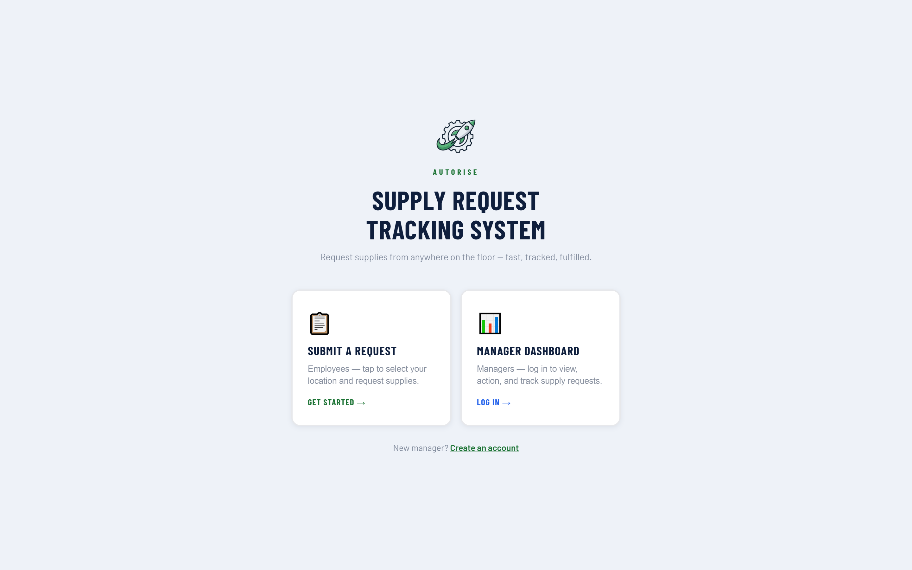
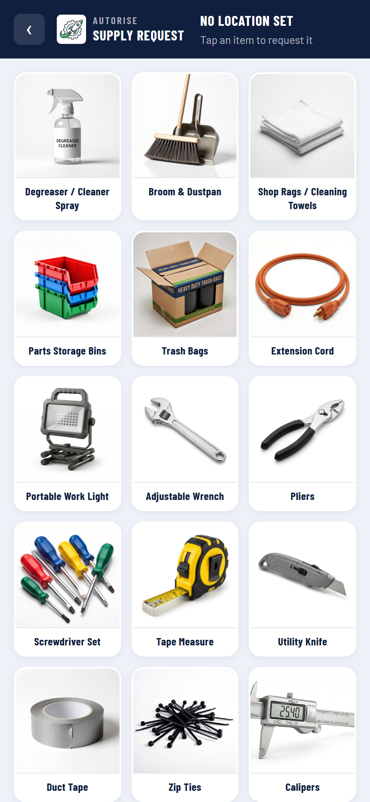
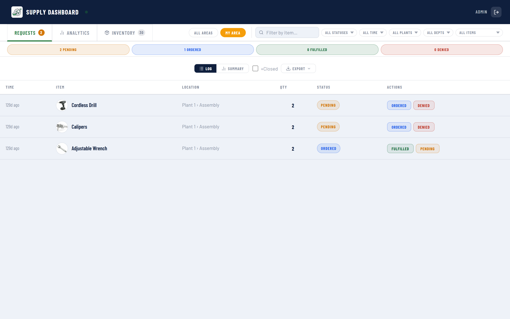

# SRTS — Supply Request Tracking System

*Sanitized snapshot of my private repository (36 commits, Mar to Aug 2026), published Aug 2026 as a code sample. Provisioning scripts were left out, and it contains no client data or secrets.*

**Floor-to-supervisor supply requests, tracked in real time.**

[**Live demo →**](https://srts.autoriseconsulting.com/autorise) · part of a multi-tenant suite built for small and mid-market operations teams

---

## The problem

Consumable supplies on a plant floor are usually requested by walking to a supervisor,
sending an email, or writing on a whiteboard. Nobody can answer "what did we spend on gloves
last month" or "which line burns through cutting discs", because the request never became data.

## What it does

- **Visual item grid** — workers tap a photo rather than typing a part name, so the flow works for anyone regardless of literacy or language comfort
- **Location context** — plant, department, zone and line captured once per session and remembered, so repeat requests take two taps
- **Quantity modal with confirmation animation** — deliberate friction at the one step where mistakes are expensive
- **Supervisor dashboard** — realtime queue, status transitions, area filtering, delete
- **Analytics tab** — four charts plus daily/weekly/monthly aggregation to answer the spend questions above
- **Per-company inventory** — items are activated per tenant from a shared catalogue of 30 products

## Screenshots

### Landing — role selection



### Item grid (mobile) — tap to request



### Supervisor dashboard



## Stack

React 19 · Vite 8 · react-router-dom 7 · Supabase (PostgreSQL + Realtime + Storage) · Recharts · CSS Modules · Cloudflare Pages

## Architecture

Every tenant is isolated by `company_id` with the company `slug` carried in the URL, so a
single deployment serves any number of organisations without a per-client build.

```
Browser (React 19 + Vite)
   |
   |-- anon key, governed by Row Level Security
   v
Supabase
   +-- PostgreSQL   tenant-scoped tables, RLS policies per company
   +-- Realtime     dashboards update without polling
   +-- Storage      photo uploads on a public read bucket
```

**Design decisions worth calling out**

- **Tenant resolution from the URL.** `/:companySlug` resolves the company once and hydrates
  branding, location vocabulary and feature flags from a single row. Adding a client is a
  database insert, not a deployment.
- **Branding is data, not code.** Logo and brand colours live on the company record. A
  `ensureContrast()` helper darkens any supplied brand colour until it clears WCAG AA (4.5:1)
  against its background, so a client with a pale yellow brand still gets readable UI.
- **Configurable location vocabulary.** One plant calls it Plant / Department / Zone / Line,
  another calls it Site / Area / Cell / Station. Labels and option lists are stored per company
  in JSONB rather than hardcoded.
- **The anon key is the only credential in the browser.** All privileged operations are either
  RLS-permitted or handled server-side. A service-role key is never given a `VITE_` prefix,
  because Vite inlines every `VITE_*` variable it finds referenced in client source, which
  would publish the key inside the JS bundle.
- **Realtime over polling.** Supervisor dashboards subscribe to Postgres changes, so a
  submission from the floor appears without a refresh.

## Running it locally

```bash
npm install
cp .env.example .env.local   # add your own Supabase project URL + anon key
npm run dev
```

Apply the SQL in `supabase/` to your own project first, then visit `/your-company-slug`.
The `managers` table and two small migrations for custom location labels live in the
production project but are not in this snapshot, so a fresh setup needs those added.

```bash
npm run build     # production build
```

Deployed on Cloudflare Pages. `public/_redirects` contains the SPA fallback
(`/* /index.html 200`) so client-side routes survive a hard refresh.

## Notes

This is a portfolio copy of a system running in production. Operational provisioning
scripts and all client data are excluded; the application code, database schema and
architecture are intact.

Built by [Parth Patel](https://www.linkedin.com/in/parth-patel-83273a28a) — AutoRise LLC.
